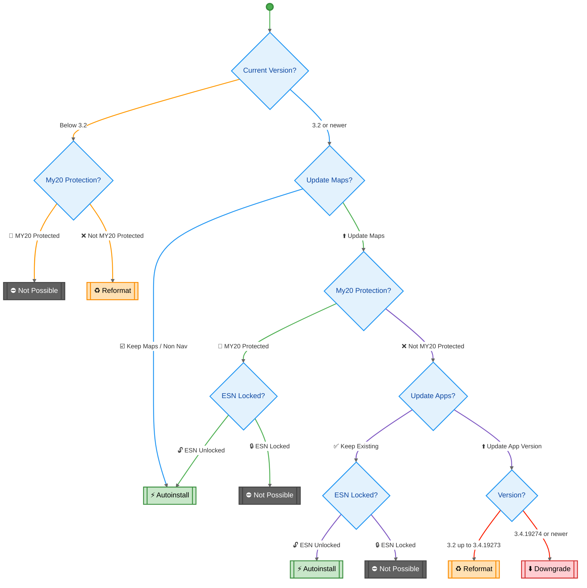
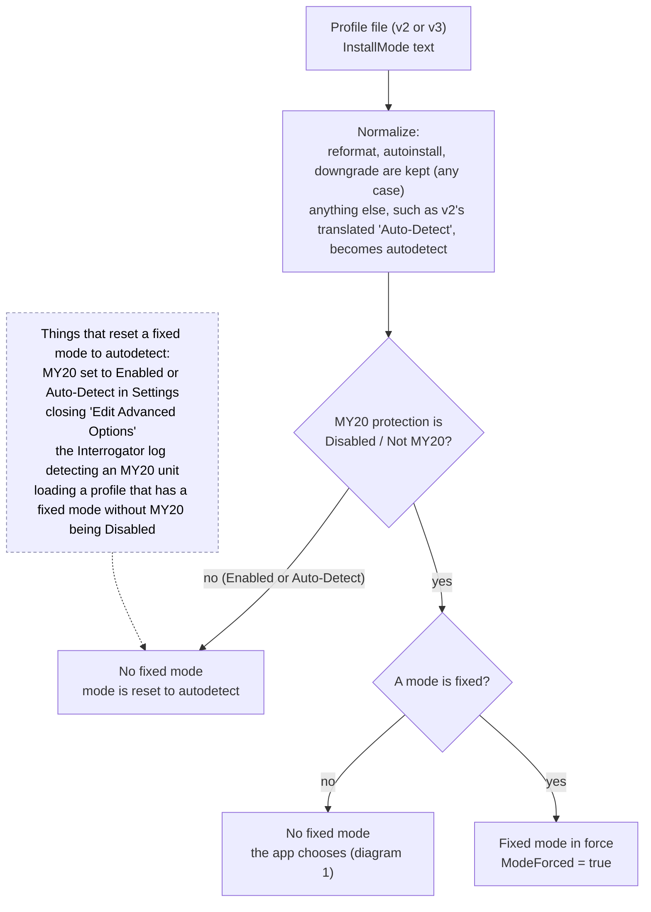

# How Syn3 Updater v3 chooses the install mode

The install mode decides what is written to the USB drive: **AutoInstall** (an `autoinstall.lst` only), **Reformat** or **Downgrade** (a `reformat.lst` as well, which makes the APIM reformat itself first).
A wrong choice can brick the APIM, so the choice is a fixed decision table, not a guess. It is the same logic as v2's `UpdateInstallMode`
(`Syn3Updater/UI/Tabs/HomeViewModel.cs`, line 657 on the `v2` branch), with the options named A to H as in v2, and `InstallModeResolver` is tested against a literal port of that method for every combination of inputs (`My20SafetyTests`).

Words used below: **MY20 protection** is the setting `My20v2`: *Enabled* (true), *Auto-Detect* (null, nothing known) or *Disabled / Not MY20* (false). A **fixed mode** is an install mode the user chose in Settings > Advanced instead of leaving it to the app.

## 1. Which mode is chosen

This runs on Home each time the release or maps selection changes (`InstallModeResolver.Resolve`, called from `HomeViewModel.ResolveInstallMode`). The chart is the intended flow, and `InstallModeFlowTests` writes it out node by node and compares it with v3 for every combination of inputs.

How the chart's boxes map to the app (v2 called the outcomes options A to H):

| Chart | In the app | v2 option |
|---|---|---|
| Below 3.2, not protected: Reformat | installed version under 3200000 | A |
| Below 3.2, protected: Not possible | error shown, Start and Download only disabled | H |
| Keep Maps / Non Nav: Autoinstall | the maps choice is "No maps", "Non-nav APIM" or "Keep existing maps" | B (below 3.4.19274), E (3.4.19274 or newer) |
| Protected, ESN locked: Not possible | the ESN-locked map is dimmed and cannot be picked (its second line says "not compatible with MY20"); if one is already selected, error shown | C-ESN, F-ESN |
| Protected, ESN unlocked: Autoinstall | | C, F |
| Not protected, Keep Existing (apps): Autoinstall / Not possible | the **"Only update maps"** release; ESN-locked maps are greyed out for it too | C, F |
| Not protected, Update App Version: Reformat / Downgrade | a normal release with a map package; Downgrade from 3.4.19274 | D, G |

Notes:
- **MY20 Auto-Detect** (nothing known yet) follows the "Not MY20 Protected" arrows. Because that can be wrong, pressing Start with a Reformat or Downgrade while MY20 is Auto-Detect asks first (diagram 3). Until it is answered, the Home banner says **MY20 Check** instead of Reformat or Downgrade, because that mode may never be used. The question's answers are "Yes or not sure: run the MY20 check" and "No, none of these apply".
- **Version boundaries** are exact: 3.2 is `3200000` and 3.4.19274 is `3419274`; there is no gap between the two Reformat/Downgrade ranges.
- **A fixed mode** (diagram 2) replaces the mode for the *Reformat*, *Downgrade* and *Keep Maps / Non Nav: Autoinstall* outcomes. The other Autoinstall outcomes (protected, or "Only update maps") and *Not possible* ignore it.
- ESN-locked maps are dimmed and cannot be picked whenever MY20 protection is Enabled or the release is "Only update maps" (`InstallModeResolver.EsnBlocked`). Every map in the list shows its ESN state: a lock for ESN locked (pre-MY20 units only), an open lock for not ESN locked (any unit, including MY20). While MY20 is Auto-Detect an ESN-locked map can still be picked (it is not known whether it fits), its line says "we'll check on Start", and pressing Start asks the MY20 question first (diagram 3).

## 2. When a fixed mode exists

v2 only let you fix the mode while MY20 protection was explicitly **off**. v3 keeps that rule in one place (`ProfileSettings`), so reformat or downgrade can never be forced onto a unit that may be MY20.

In Settings the *Install Mode* dropdown is only enabled while *MY20 Protection* is set to Disabled, which is why MY20 is the first dropdown.

## 3. What happens when you press Start

## Where it lives

| What | Code |
|---|---|
| The decision table (diagram 1) | `src/Syn3Updater.Core/Services/InstallModeResolver.cs` |
| Calls it and shows the invalid-config error | `HomeViewModel.ResolveInstallMode` |
| Fixed-mode rules (diagram 2) | `ProfileSettings` (`My20v2`, `InstallMode`, `ModeForced`) and `SettingsStore.MigrateProfile`; Settings dropdown rules in `SettingsViewModel` |
| The Start steps (diagram 3) | `HomeViewModel.StartAsync` path, `Workflow.StartAsync`, `UpdateRunner` (which lists are written) |
| Tests | `My20SafetyTests` (decision table against v2, fixed-mode rules), `AppTests` (Home flows) |
