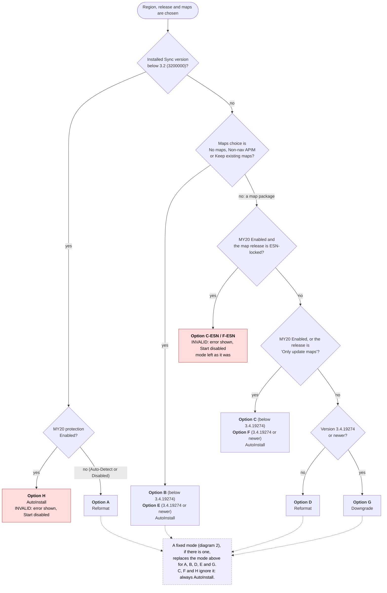
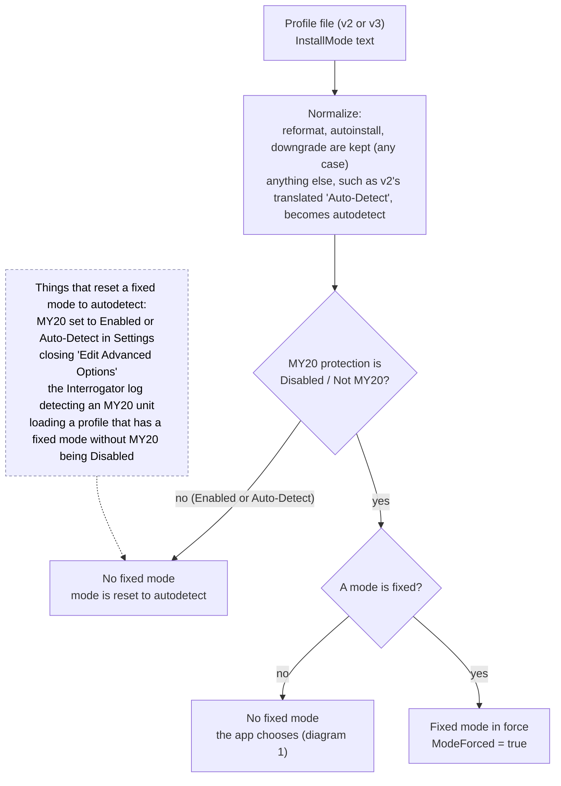
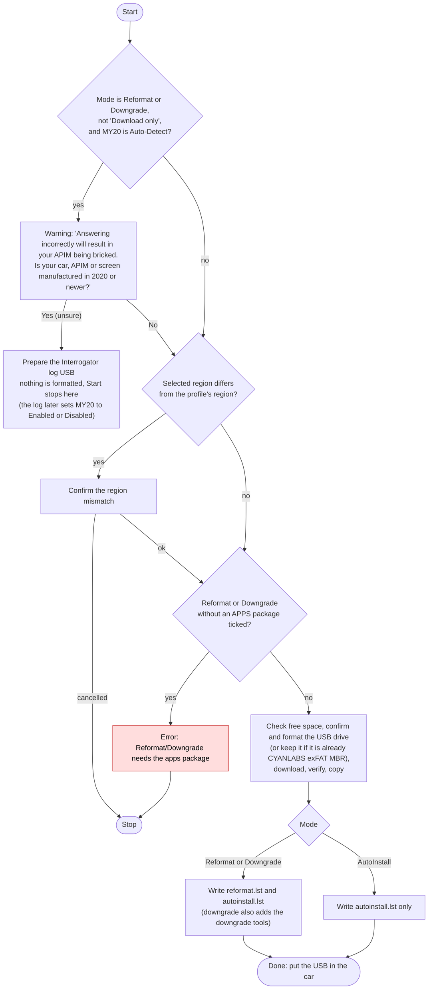

# How Syn3 Updater v3 chooses the install mode

The install mode decides what is written to the USB drive: **AutoInstall** (an `autoinstall.lst` only), **Reformat** or **Downgrade** (a `reformat.lst` as well, which makes the APIM reformat itself first).
A wrong choice can brick the APIM, so the choice is a fixed decision table, not a guess. It is the same logic as v2's `UpdateInstallMode`
(`Syn3Updater/UI/Tabs/HomeViewModel.cs`, line 657 on the `v2` branch), with the options named A to H as in v2, and `InstallModeResolver` is tested against a literal port of that method for every combination of inputs (`My20SafetyTests`).

Words used below: **MY20 protection** is the setting `My20v2`: *Enabled* (true), *Auto-Detect* (null, nothing known) or *Disabled / Not MY20* (false). A **fixed mode** is an install mode the user chose in Settings > Advanced instead of leaving it to the app.

## 1. Which mode is chosen

This runs on Home each time the release or maps selection changes (`InstallModeResolver.Resolve`, called from `HomeViewModel.ResolveInstallMode`).

| Option | Installed version | MY20 protection | Maps / release | Mode | Fixed mode used? |
|---|---|---|---|---|---|
| A | below 3.2 | Auto-Detect or Disabled | anything | Reformat | yes |
| H | below 3.2 | Enabled | anything | AutoInstall, **invalid** | no |
| B | 3.2 up to 3.4.19273 | anything | no map package | AutoInstall | yes |
| E | 3.4.19274 or newer | anything | no map package | AutoInstall | yes |
| C-ESN, F-ESN | 3.2 or newer | Enabled | ESN-locked map | **invalid** (mode unchanged) | n/a |
| C | 3.2 up to 3.4.19273 | Enabled, or "Only update maps" | map package | AutoInstall | no |
| F | 3.4.19274 or newer | Enabled, or "Only update maps" | map package | AutoInstall | no |
| D | 3.2 up to 3.4.19273 | Auto-Detect or Disabled | map package, normal release | Reformat | yes |
| G | 3.4.19274 or newer | Auto-Detect or Disabled | map package, normal release | Downgrade | yes |

ESN-locked maps are also greyed out in the maps list whenever MY20 protection is Enabled or the release is "Only update maps".

## 2. When a fixed mode exists

v2 only let you fix the mode while MY20 protection was explicitly **off**. v3 keeps that rule in one place (`ProfileSettings`), so reformat or downgrade can never be forced onto a unit that may be MY20.

In Settings the *Install Mode* dropdown is only enabled while *MY20 Protection* is set to Disabled, which is why MY20 is the first dropdown.

## 3. What happens when you press Start

## Where it lives

| What | Code |
|---|---|
| The decision table (diagram 1) | `src/Syn3Updater.Core/Services/InstallModeResolver.cs` |
| Calls it and shows the invalid-config error | `HomeViewModel.ResolveInstallMode` |
| Fixed-mode rules (diagram 2) | `ProfileSettings` (`My20v2`, `InstallMode`, `ModeForced`) and `SettingsStore.MigrateProfile`; Settings dropdown rules in `SettingsViewModel` |
| The Start steps (diagram 3) | `HomeViewModel.StartAsync` path, `Workflow.StartAsync`, `UpdateRunner` (which lists are written) |
| Tests | `My20SafetyTests` (decision table against v2, fixed-mode rules), `AppTests` (Home flows) |
